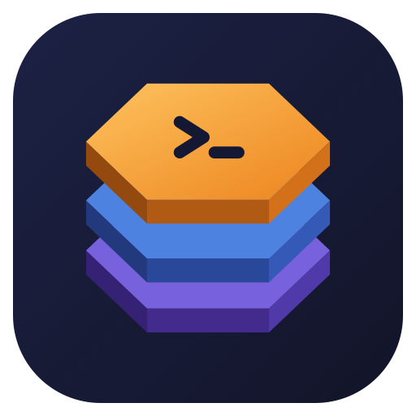
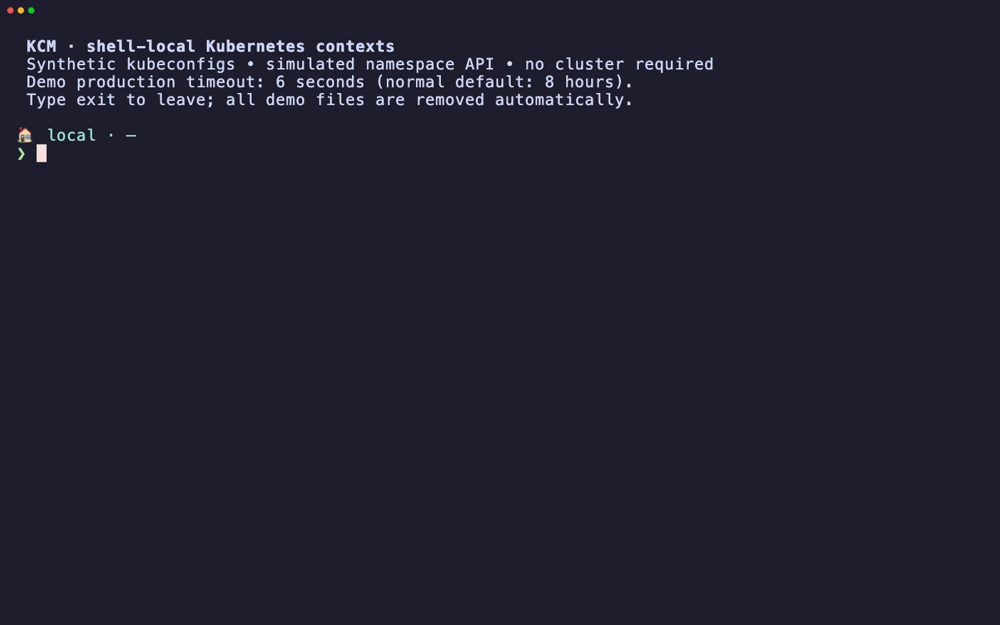

<p align="center">
  
</p>

# kube-context-manager (`kcm`)

Keep Kubernetes profiles and context selection in your shell. Leave a terminal
in production overnight, and KCM returns it to `local` before your next command
runs.

KCM uses **shared kubeconfig files**, **shell environment variables**, and **fzf**.
It does not create per-shell kubeconfig copies or change a source file's
`current-context`. Namespace changes are shared between shells using that context.

## Demo



A quick look at listing contexts, selecting a profile and context, namespaces,
and expiry. Recorded with synthetic configs and a simulated namespace API.
The demo uses a six-second production timeout; the normal default is eight hours.
The active menu choice is highlighted in bright pink with black text.
Try it with `make demo`, or regenerate the GIF with `make demo-gif`.
See the [demo guide and VHS sequence](demo/README.md) for dependencies and details.

## Install

Requires Go 1.25+, [fzf](https://github.com/junegunn/fzf) 0.52+, and zsh or bash 4.4+.
`kubectl` is needed for namespace discovery. No gum or yq dependency.

```sh
git clone https://github.com/mikeoertli/kube-context-manager.git
cd kube-context-manager
make install                     # installs kcm to GOBIN or GOPATH/bin
kcm settings init                # optional; built-in defaults also work
```

Ensure the Go bin directory is on `PATH`. On macOS, `brew install go fzf` provides
the dependencies; `brew install bash` provides a modern bash if desired. Apple's
bundled bash 3.2 does not support KCM's Enter-time expiry integration.

### Homebrew

```sh
brew install mikeoertli/tap/kcm
brew update
brew upgrade mikeoertli/tap/kcm
```

Homebrew installs the dependencies declared by the tap. A compatible prebuilt
bottle avoids local compilation; otherwise Homebrew builds from source.

### Shell integration (required for session switching and timeouts)

Add this **after shell plugins and keybindings** in `~/.zshrc`:

```sh
eval "$(kcm init zsh)"
```

For bash, use `eval "$(kcm init bash)"` in `~/.bashrc` and ensure your interactive
login shell sources that file. Open a new shell after setup.

`kcm init zsh` **prints shell code**. The surrounding `eval "$(...)"` runs that
code in your current shell. This is necessary because an ordinary executable
cannot change its parent shell's environment variables.

Evaluating the integration:

- Starts the shell in `local`, clears its context and timeout, and sets
  `KUBECONFIG=/dev/null` until you select a context.
- Defines a `kcm` shell function so profile/context changes, `clear`, and `renew`
  can update this shell's environment.
- Defines `kcmkubectl`, `kcmhelm`, and `kcmk9s` to pass the selected context to
  those clients. Standard client commands are not replaced.
- Installs prompt and Enter-key hooks for expiry reset and command cancellation.
- Prepares exported text for Starship using shell built-ins at each prompt.
- Runs `kcm doctor --quiet` to check local settings and configs without contacting
  a cluster.

It does not install tab completion. Running `kcm init zsh` without `eval` only
displays the code; it does not initialize the shell or edit your startup file.
Evaluating it again resets that shell to `local` with no context selected.

Standalone commands such as `kcm list`, `kcm install`, and `kcm settings init`
can run without shell integration. Profile/context switching and interactive
timeouts require it.

## Everyday use

Use `kcm list` to list discovered contexts across all configured profiles. Each
section shows its directory, contexts, namespaces, servers, and source files;
empty profiles are included. `*` marks the effective global context that standard
clients would use (`KUBECONFIG`, or `~/.kube/config` when unset). `>` marks this
shell's KCM selection; `*>` means both selections match. Markers also work in
redirected output. The command only reads local files and does not query clusters
or permissions. `kcm contexts` continues to list only the current profile.

```sh
kcm                          # fuzzy-select a local context
kcm profile                  # pick a profile, then a context in one flow
kcm profile prod             # or set only the profile explicitly
kcm context customer-a
kcmkubectl get pods           # supplies --context customer-a
kcmhelm list                  # supplies --kube-context customer-a
kcmk9s                        # supplies --context customer-a
kcm ns                       # choose an existing namespace or create a new one
kcm ns app                   # update this context's shared namespace
kcm ns feature-demo --create  # create in the selected cluster, then switch
kcm status                   # profile, context, namespace, expiry
kcm profile local            # explicitly leave production
```

Every new shell starts in `local`, including a new interactive child shell.
`kcm profile` opens the profile picker followed by that profile's context picker.
Both selections apply together. Cancelling either picker, selecting an empty
profile, or encountering an error leaves the shell unchanged. The new selection
starts the profile's configured timeout and remembers the previous selection.

`kcm profile NAME` clears the context and timeout without opening a picker.
**Choose a context before using a client.** Plain `kcm` continues to select a
context in the current profile.
With no selection, `KUBECONFIG=/dev/null` prevents fallback to a shared default
config. Selecting a context sets `KUBECONFIG` to its source file.

Use `kcmkubectl`, `kcmhelm`, and `kcmk9s` to pass this shell's selected context
to the corresponding client. KCM does not define or replace `kubectl`, `helm`,
or `k9s` commands, aliases, or functions. Those commands still inherit
`KUBECONFIG`, but use the source file's `current-context` unless you supply an
explicit context flag. In scripts, use `kcm exec -- kubectl ...` (or `helm`/`k9s`).

If upgrading from the unprefixed wrappers, open a fresh shell after rebuilding
or reinstalling KCM; existing shells retain their previously loaded functions.

| Profile | Default directory | Default timeout |
| --- | --- | --- |
| 🏠 `local` | `~/.kube/` (direct files) | Disabled |
| 🛠️ `dev` | `~/.kube/dev/` | Disabled |
| 🧪 `qa` | `~/.kube/qa/` | Disabled |
| 🚨 `prod` | `~/.kube/prod/` | 8 hours |
| 🌐 `other` | `~/.kube/other/` | Disabled |

Directories are scanned non-recursively. Hidden files, subdirectories, backup
files ending in `~` or `.bak`, certificate/key files (`.pem`, `.crt`, `.key`),
and documentation (`README`, `LICENSE`, `NOTICE`, `.md`, `.markdown`, `.rst`)
are excluded. Other unrelated files, including ordinary YAML/JSON documents,
are ignored. Kubeconfigs are recognized by their contents or conventional names
(`config`, `kubeconfig`, `*.kubeconfig`, `kubeconfig.*`); malformed recognized
configs still produce an error.

### Select a profile and context directly

```sh
kcm dev --context api-dev
kcm prod --context api-prod --file ~/.kube/prod/config  # disambiguate duplicate names
kcm reset
```

`kcm PROFILE --context NAME` validates both names before changing this shell,
remembers the previous profile and context, and starts the selected context's configured
timeout. An unknown profile, missing context, or ambiguous name returns an error
and preserves the existing selection. Profile names that match built-in commands
must use `kcm profile NAME` followed by `kcm context NAME` instead.
Plain `kcm` still opens the current profile's context picker.

`kcm reset` selects a local endpoint in the `local` profile: the only context,
otherwise one from the file named `config`, otherwise the first context in stable
name/path order. It clears previous-context history and applies the local
profile's timeout (normally none). It works even if `auto_revert_local` is
disabled. No eligible local context or invalid configuration returns an error
without changing the shell. Waived remote endpoints are excluded.

After upgrading, open a new shell or reload `eval "$(kcm init zsh)"` (or bash)
to enable these commands in the current shell.

### Toggle the previous context

```sh
kcm dev --context api-dev
kcm qa --context api-qa
kcm -                         # back to dev / api-dev
kcm -                         # back to qa / api-qa
```

Like `cd -`, each invocation swaps the current and previous selection, including
its profile and exact kubeconfig path. `kcm context -` does the same thing.
Re-selecting the current context preserves the previous one. Contexts must still
exist in their profile: missing history, removed configs, and invalid targets
return an error without changing the shell. Normal selection timeout rules apply;
returning to a different profile starts its configured timeout.

### Browse recent selections

```sh
kcm history                   # searchable history picker, newest first
kcm history --list            # numbered list without switching
kcm history 2                 # select the second entry
```

History remembers the last **20 distinct previous selections**, identified by
profile, context, and kubeconfig path. The current selection is excluded.
Selecting a history entry validates that it still exists in the configured
profile, then makes it current and moves the outgoing selection to the front.
`kcm -` uses the most recent entry. Renaming a context also updates matching
history entries in that shell.

History belongs to this shell and is stored in environment variables, without
a history file or credentials. New shells, `kcm reset`, `kcm clear`, and timeout
expiry clear it, so history cannot jump straight back to an expired selection.
Removed or invalid entries remain visible until they age out or history is
cleared; selecting one returns an error and preserves the current selection.

### Kubeconfigs maintained in repositories

Symlink a repo-managed kubeconfig into the desired profile directory:

```sh
ln -s ~/repos/cluster-configs/customer.yaml ~/.kube/prod/customer.yaml
kcm profile prod
kcm context customer-a --file ~/.kube/prod/customer.yaml
```

KCM uses the **link's location** for profile membership, discovery names, timeout
classification, selection, and waivers. The target can be outside `~/.kube`.
`KUBECONFIG` and `KCM_FILE` retain the link path, and two links to the same target
remain distinct selectable entries. Broken links produce an error; directory
links are not scanned recursively.

Namespace changes update the shared target file and preserve the symlink, so
those edits also appear in the repository. Relative certificate/token paths
follow the standard client's rules and are relative to the link's directory;
use embedded data or absolute paths for configs whose supporting files live
in the repository. Non-local configs linked into the root still require a waiver.

### Returning home after a timeout

The timer starts when you select a context with a timeout. Changing contexts
does not extend an existing deadline; `kcm renew` explicitly restarts it.

For a longer session, override the deadline without editing your config:

```sh
kcm renew --for 24h      # expire 24 hours from now (96h also works)
kcm renew --extend 24h   # add 24 hours to the existing active deadline
kcm renew               # restart the timeout configured for this profile
```

The two flags are mutually exclusive and require a duration of at least one
second. `--extend` needs an unexpired deadline; use `--for` if there is no active
timer. Renewals affect only this shell. Later context selections apply normal
profile rules and can shorten an extended deadline; selecting an untimed context
clears it. Switching profiles or clearing the selection also clears the timer.

- At a **stale prompt**, pressing Enter resets the profile to `local`, selects
  a local context automatically, and **cancels the entire submitted command
  line**. A notice tells you which context was selected.
- If time expires while a command is running, KCM resets at the next prompt.
- Nothing runs in the background. Credentials are not expired or revoked.
  Running tools and scripts continue normally.

Automatic local selection is enabled by default. Set this top-level option in
`~/.config/kcm/kcm_config.toml` to return without selecting a context instead:

```toml
auto_revert_local = false
```

With automatic selection enabled, KCM uses the only eligible local context if
there is one. Otherwise it prefers contexts from the file named `config` in the
local profile directory, then the first remaining context. Within those groups,
contexts are sorted by name and then source path. Symlinks retain their link
paths. Waived non-local contexts are never automatic return targets.

Expiry clears the old deadline and previous-context history. If there are no
eligible local contexts, or settings/config discovery fails, the shell returns
to local without a context selected. KCM does not change a source file's stored
`current-context`. New shells still start without a context selected. Open a new
shell after upgrading to load the updated expiry hook.

This is an interactive-shell reminder, not an access-control boundary. Custom
widgets that bypass `accept-line`, other shell integrations that replace KCM's
Enter bindings, and commands sent without the normal line editor bypass that
check. KCM does not wrap every client invocation with a timeout gate.

### Inspecting the shell selection

`kcm status` shows a formatted session summary, including the profile directory
and any expiry time. Terminal output uses color; redirected output and `NO_COLOR`
omit color codes. A fresh local shell has no context selected, so status displays
**Not selected** instead of `/dev/null`. Select a local context with `kcm context`
to see its actual kubeconfig path. Namespace changes affect other shells using
the same context in that source file.

Use these commands when you need just a value for a script:

```sh
kcm print-kubeconfig    # alias: kcm kc
kcm print-context-name # alias: kcm ctx

# In a script, stop if either value is unavailable:
config=$(kcm kc) || exit 1
context=$(kcm ctx) || exit 1
kubectl --kubeconfig "$config" --context "$context" get pods
```

They print the selected source path or context name plus a newline. If there is
no valid selection, they return an error and leave stdout empty. They preserve
symlink paths and do not query the cluster or change shell state.

In 0.6.0, `ctx` changes from a selection alias to a print command. Use
`kcm context NAME` to switch contexts. Open a new shell after upgrading so its
shell function recognizes the new alias correctly.

## Import kubeconfigs

`kcm import` finds a recent download, guides profile/name choices, and offers
to simplify generated or complex names:

```sh
kcm import                              # newest filename match on Desktop/Downloads
kcm import --select                     # search those matches, newest first
kcm import --dir ~/Downloads --profile dev  # searchable directory picker
kcm import --file ./download.yaml --profile qa --name api-qa

# Import with readable labels:
kcm import --file ./download.yaml --profile dev --name api-dev \
  --readable --no-prompt

# Preserve the file's labels:
kcm import ./download.yaml --profile qa --name api-qa \
  --skip-readable --no-prompt

# Keep the original file rather than moving it:
kcm import ./download.yaml --profile dev --name api-dev --import-copy

# Import kubeconfig text copied to the clipboard:
kcm import --clipboard --profile dev --name api-dev --readable

# Import for later use without changing this shell:
kcm import ./download.yaml --profile dev --name api-dev --import-only --no-prompt
```

Default discovery looks only at direct files in `~/Desktop` and `~/Downloads`,
matching names containing `.kubeconfig`, or extensionless names containing
`kube` or `config`, case insensitively. It selects the newest by modification
time; ties use the absolute path. Filename discovery does not validate contents:
the selected file must pass kubeconfig validation before import. Missing default
directories are ignored; no matches produce an error with explicit source options.

`--file PATH` (or a file argument) accepts any filename and bypasses discovery.
`--dir DIR` (or a directory argument) searches all regular files in that directory,
without recursion. File pickers show modification times and retain newest-first
order while filtering. With `--no-prompt`, a directory source uses its newest
regular file directly. Use `--file` to pin the exact source in a script.

`--name` is the exact destination filename (also available as `--filename`),
relative to the chosen profile directory. Namespaces are preserved unless
`--namespace` is given. File imports **move by default**: KCM verifies the
destination, archives the exact original under `kube_root/archive/`, then removes
the source. Use `--import-copy` to leave the source file in place. Moving requires
every source context; choose `--all-contexts` or use `--import-copy` for a partial
import. Symlink sources also require `--import-copy`. Successful imports select
the imported profile and context for this shell and start the profile's configured
timeout. Use `--import-only` to leave the current selection unchanged. With
`--all-contexts`, KCM selects the source's valid `current-context`, falling back to
the first context by name. Dry runs and failed or cancelled imports do not change
the shell selection.

Automatic selection requires the `kcm init` shell integration. In scripts that
call the binary directly, use `--import-only` (or `--dry-run` for validation).
After upgrading, start a new shell or re-run `eval "$(kcm init zsh)"` (or bash)
to load the updated import integration.

`kcm install` retains its original copy default and
`--move`/`--copy` flags; `kcm import` uses `--import-copy` instead.

`--clipboard` accepts kubeconfig text instead of a file, directory, or default
download. It reads without clearing or modifying the clipboard. Content is
staged privately (directory `0700`, file `0600`), validated, imported, and the
temporary file removed on success, failure, or dry run. The default destination
name is `clipboard.kubeconfig`; use `--name` to change it. Relative certificate,
key, token-file, and executable paths resolve from the current directory, so run
the command where those references are available. Clipboard support uses
`pbpaste` on macOS, or `wl-paste`, `xclip`, or `xsel` on Linux.

Interactive imports offer readability updates if labels or the destination
filename look generated or complex: UUIDs, long hexadecimal IDs, names over
48 characters, or punctuation beyond letters, digits, `.`, `_`, and `-`.
`--readable` always enables the naming step; `--skip-readable` suppresses it and
preserves labels. The skip flag cannot be combined with individual rename flags.

With `--readable --name api-dev`, suggested labels are `api-dev` for the cluster
and context and `api-dev-user` for the user. Common config extensions are removed
from that base. If the filename itself is complex, defaults use `PROFILE-cluster`
and `PROFILE-cluster-user`. Anonymous contexts remain anonymous. Interactive
prompts let you override each label; scripts use these defaults. Individual
`--rename-cluster`, `--rename-user`, and `--rename-context` flags override them.

`--no-prompt` preserves labels unless `--readable` or explicit rename flags are
supplied. Remote sources require `--profile` in scripted use. Multi-context files
require `--context NAME` or `--all-contexts` without prompts; readability updates
require a single selected context. Use `--dry-run` to preview without writing.

`kcm install` remains available for explicit source paths and its original wizard:

```sh
kcm install ~/Downloads/customer.yaml       # interactive wizard

kcm install ./customer.yaml --profile prod \
  --rename-cluster customer-a \
  --rename-user customer-a-support-ro \
  --rename-context customer-a \
  --namespace app --no-prompt

kcm install ./local.yaml --no-prompt        # local endpoint: defaults to local
kcm install ./remote.yaml --profile other --no-prompt --move
kcm install ./bundle.yaml --profile dev --all-contexts --no-prompt --dry-run
```

The wizard selects a source context, destination profile, readable names,
namespace, filename, and copy/move behavior, then shows a confirmation. All
choices have matching flags. Missing rename flags preserve names with
`--no-prompt`; a remote config requires an explicit `--profile`. Interactive
imports suggest `other` for otherwise unclassified remote endpoints.

For multi-context files, use `--context NAME` or `--all-contexts`. A selected
context imports only its referenced cluster and user. Renaming is available
for single-context imports. `--namespace` can apply to every imported context.

Imports never overwrite destination files. They embed referenced certificates
and keys and preserve token-file and exec paths as absolute paths. External
token files and auth helpers must remain available. Copy is the default;
`--move` requires importing every source context, verifies the installed config,
and archives the original under `kube_root/archive/` before removing the source.
New config and archive files have mode `0600`.

## Make an existing kubeconfig readable

`kcm rename` (alias `kcm make-readable`) renames entries **in place**, with a
backup of the exact original file. Use the wizard or supply flags:

```sh
kcm rename                             # use this shell's selected file/context
kcm rename ./download.yaml             # prompt for readable names and confirm

kcm rename ./download.yaml --context old-context \
  --rename-cluster api-dev --rename-user dev-reader \
  --rename-context api-dev --no-prompt

kcm rename --rename-context api-dev --no-prompt --dry-run
```

Without a selected file, the wizard offers files in the current profile or lets
you enter another path. Source context selection follows `--context`, then this
shell's selection when it refers to that file, then the file's valid
`current-context`, then the first context by name. Omitted names are prompted
interactively and preserved with `--no-prompt`. A context with no user stays
anonymous. Use `--namespace NAME` to change only the selected context's
namespace, or `--namespace ''` to clear it; otherwise namespaces are preserved.

Cluster and user renames update **all references in that file**. Other contexts,
unused entries, credentials, extensions, and relative file references are
preserved. The file's stored `current-context` becomes the resulting context.
Existing names cannot be overwritten. No cluster requests or credential helpers
run, and neither `yq` nor `gum` is required.

Before writing, KCM checks that the source has not changed during the wizard and
archives its original bytes under `kube_root/archive/` with a unique filename.
An unsuccessful backup prevents the edit. Writes are atomic with mode `0600`;
symlinks remain links and their target file is updated. The output includes the
backup path and commands to compare or restore it. `--dry-run` writes nothing;
an unchanged request also creates no backup. YAML formatting/comments may change.

With shell integration, renaming the active or previous context updates that
shell's selection without extending its deadline. The plan/backup summary goes
to stderr so stdout can carry the shell update internally. Other open shells
using the old name need to reselect it. Open a new shell after upgrading to load
the updated integration. If a renamed root context had a waiver, recreate the
waiver using its new name with `kcm waive NAME --file PATH`.

## Namespace picker and creation

`kcm context`, `kcm profile`, and `kcm namespace` (alias `ns`) open fzf pickers
when called without a name. The active row has a bright pink background and black
text; use the arrow keys to move and Enter to confirm.
The namespace picker queries the selected cluster
and includes **Create new namespace…**. Choose it, enter a name, and KCM creates
the namespace before switching. The name prompt identifies the profile and
context; a blank name or Ctrl-C cancels.

Use `kcm ns NAME --create` to create and switch directly, or `kcm ns --create`
to prompt only for the new name. Creation requires cluster permission. If it
fails (including when the name already exists), the configured namespace stays
unchanged. `kcm ns NAME` only changes the shared config; it neither creates a
namespace nor checks whether it exists. All namespace switches remain shared
between shells using that source context.

## Permissions on demand

```sh
kcm permissions                          # live summary for the selected context
kcm permissions customer-a -n app        # inspect without switching contexts
kcm permissions --details                # full returned rules and restrictions
kcm can-i delete deployments.apps -n app
kcm can-i get pods/my-pod --subresource log -n app
kcm can-i list nodes --context customer-a
```

Checks run only when requested, with no caching or automatic picker/prompt queries.
They use the current profile's contexts and leave shell selection and kubeconfigs
unchanged. Summaries identify their namespace and preserve resource-name restrictions;
incomplete results are labeled. `can-i` exits `0` for allowed, `1` for not allowed,
and `2` for a failed or inconclusive check. See [permission checks](docs/permissions.md)
for scope, options, and limitations.

## Settings and local-only checks

The settings file is `~/.config/kcm/kcm_config.toml`. See the complete
[example settings](internal/kcm/defaults.toml), which KCM also uses as its defaults.

Upgrading from an earlier version: rename `kcm_settings.toml` to
`kcm_config.toml` in that directory and update any explicit `KCM_SETTINGS` or
`--settings` paths. Existing initialized shells retain their exported settings
path; update it or open a new shell after renaming the file.

Override the root, add profiles, choose emoji, or disable a timeout:

```toml
kube_root = "~/kubeconfigs"
local_hosts = ["kubernetes.docker.internal"]
local_cidrs = ["192.168.49.2/32"]

[profiles.prod]
timeout = "0"                 # disabled; normal default is "8h"

[profiles.support]
dir = "support"               # relative to kube_root; absolute paths work too
emoji = "🧰"
timeout = "2h"
```

`localhost` and loopback IPs are local by default. Private network addresses are
not automatically local, and classification never performs DNS lookups. An
omitted timeout defaults to eight hours for `prod` or a selected source under
`kube_root/prod/`; other profiles have no timeout. An explicit profile timeout
takes precedence. Settings changes apply on the next selection or `kcm renew`.

Non-local contexts at the root produce an error until moved or waived:

```sh
kcm doctor
kcm waive deliberately-local-tunnel
kcm waivers
kcm unwaive deliberately-local-tunnel
```

Waivers live in `kube_root/.kcm_waivers` as readable JSON. Each binds to the
context name, absolute source path (the link path for symlinks), and server
address. Changing any of those requires a new waiver. Discovery never relocates
files automatically.

Use `KCM_SETTINGS=/path/to/settings.toml` or `--settings PATH` for alternate
settings. For a shell that always uses an alternate file:

```sh
eval "$(kcm --settings /path/to/settings.toml init zsh)"
```

## Completions and Starship

### Tab completion (optional)

Completion teaches the shell which commands, flags, profiles, and contexts to
suggest when you press **Tab**, such as after `kcm profile `. It does not initialize
KCM, select a profile/context, or install expiry hooks.

Add this to `~/.zshrc` after `compinit` (usually run by your shell framework):

```sh
source <(kcm completion zsh)
```

For bash, add `source <(kcm completion bash)` to `~/.bashrc`.
`kcm completion zsh` prints completion code; `source <(...)` loads it into the
current shell. Put both setup lines in your startup file if you want session
integration and completion:

```sh
# ~/.zshrc — after plugins, keybindings, and compinit
eval "$(kcm init zsh)"          # Session state, client wrappers, expiry hooks
source <(kcm completion zsh)    # Tab completion only
```

Fish and PowerShell completion generation is also available; session integration
supports zsh/bash.

### Starship (optional display)

Starship displays KCM's exported shell state. It does not replace initialization
or provide KCM tab completion.

For Starship, use the [suggested config block](docs/starship.md) or copy
[examples/starship.toml](examples/starship.toml) into your `~/.config/starship.toml`.
It replaces the built-in `[kubernetes]` module and old context/user regex rules
with styles based on the profile-to-directory mapping: local green, dev yellow,
qa red, prod magenta, and other orange, with a fallback for custom profiles.

The guide covers a two-line layout with KCM on the right, custom profile colors,
emoji overrides, and migration from
the previous `[custom.kcm*]` snippets. Native `env_var` modules display the
shell-selected context and countdown without starting prompt subprocesses.
Namespace remains available through `kcm status`.

## Command reference

| Command | Function |
| --- | --- |
| `kcm`, `kcm context [name\|-]` | Select a context; `kcm -` toggles the previous profile/context |
| `kcm PROFILE --context NAME` | Select a validated profile and context together |
| `kcm reset` | Return to the preferred local context |
| `kcm history [NUMBER] [--list]` | Pick, list, or select recent shell-local profile/context selections |
| `kcm profile [name]` | Pick a profile and context; with a name, set only the profile |
| `kcm namespace [name] [--create]` | Pick a shared namespace, or create and switch |
| `kcm list` | List contexts grouped by profile, marking global and shell selections |
| `kcm contexts`, `kcm profiles` | List available contexts or profiles |
| `kcm permissions [CONTEXT] [--details]` | Inspect live permissions for one namespace |
| `kcm can-i VERB RESOURCE` | Check one API action without executing it |
| `kcm status`, `kcm prompt` | Detailed status or compact prompt output |
| `kcm kc`, `kcm ctx` | Print the selected kubeconfig path or context name |
| `kcm clear`, `kcm renew [--for DURATION\|--extend DURATION]` | Clear selection, restart, or extend its timer |
| `kcm install PATH` | Import, rename, copy, or move configs |
| `kcm import [PATH]` | Import and select a context; use `--import-only` to keep the current selection |
| `kcm rename [PATH]` | Make existing config names readable, with backup and optional dry run |
| `kcm waive NAME`, `kcm unwaive NAME`, `kcm waivers` | Manage root exceptions |
| `kcm doctor` | Validate settings and config layout |
| `kcm init SHELL`, `kcm completion SHELL` | Generate integration and completions |
| `kcm settings init`, `kcm settings path` | Create or locate settings |
| `kcm exec -- CLIENT ARGS` | Pass the selected context to kubectl, helm, or k9s |
| `kcmkubectl`, `kcmhelm`, `kcmk9s` | Shell wrappers that pass the selected context to each client |
| `kcm version`, `kcm help [COMMAND]` | Version and help |

Every `kcm` command supports `--help`; wrapper arguments pass through to the client.
Aliases: `kc` for `print-kubeconfig`, `ctx` for `print-context-name`, `ns` for `namespace`,
and `make-readable` for `rename`. See
[complete command help](docs/commands.md) and [behavior details](docs/design.md).

## Development

```sh
make build                  # bin/kcm
make check                  # formatting, vet, unit/integration tests
python3 tests/shell_integration.py ./bin/kcm --bash /path/to/modern/bash --fzf /path/to/fzf
```

Tests use temporary fixture configs and do not contact a Kubernetes cluster.
Go dependencies are pinned in `go.mod` and verified by the committed `go.sum`.
`VERSION` is the sole source of the application's version, embedded at compile
time for Make builds and direct `go build`, `go install`, or `go run` commands.
Update that file and rebuild to change the reported version.

### Homebrew releases

[`.github/workflows/homebrew.yml`](.github/workflows/homebrew.yml) notifies
[`mikeoertli/homebrew-tap`](https://github.com/mikeoertli/homebrew-tap) when a
stable `vMAJOR.MINOR.PATCH` tag is pushed. Keep the tag aligned with `VERSION`
and include the workflow in the tagged commit. For the current version, the
release tag is `v0.5.0`.

The workflow uses the **TAP_DISPATCH_TOKEN** repository secret to trigger the
tap's release updater for `kcm`. The token needs **Actions: Read and write**
access to the tap repository. See the [tap's setup instructions](https://github.com/mikeoertli/homebrew-tap#notify-the-tap-when-a-project-is-tagged)
for token configuration and the publishing process.

The tap opens an update PR, builds and tests its packages, and provides a
separate bottle-publishing step. The notification does not publish the package
on its own. Prerelease tags are skipped, and existing tags are not retriggered.
After the tap update is published, use `brew update` and `brew upgrade` on each
computer to install it. Ordinary branch pushes do not change the packaged version.

## Related

Check out my new Kubernetes resource monitor TUI too – [`krm` (kube-resource-monitor)](https://github.com/mikeoertli/kube-resource-monitor).
